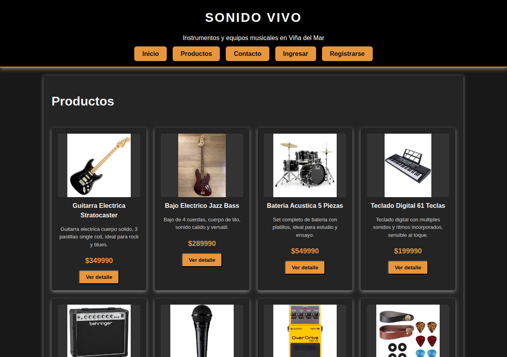

# Sonido Vivo

Sitio web para una tienda de instrumentos y equipos musicales de Viña del Mar.

**Evaluación 3 — Desarrollo FullStack II:** aplicación Full Stack completa: React + Spring Boot + MySQL,
con CRUD guardado en la base de datos, Swagger y autenticación JWT con roles **ADMIN** y **USER**.

Los dos proyectos están **separados** y se ejecutan por separado (backend en IntelliJ, frontend en VSCode):

| Parte | Tecnología | Carpeta | Puerto |
| :--- | :--- | :--- | :--- |
| **Base de datos** | MySQL 8 o XAMPP (MariaDB). Las tablas las crea Flyway | [`database/`](database/) (script de respaldo) | 3306 |
| **Backend** | API REST con Spring Boot 3.5 | [`backend/`](backend/) | 8080 |
| **Frontend** | React + Vite + **Axios** (migración del sitio de la primera entrega, mismo diseño) | [`frontend/`](frontend/) | 5173 |

**Integrantes:** Bastian Alarcón e Ignacio Hidalgo.



## Backend (Spring Boot + MySQL)

- **Semana 1:** entidades **Producto**, **Cliente** y **Venta** sobre una base de datos MySQL normalizada a 3FN,
  con repositorios, servicios y controladores con los 5 endpoints CRUD cada una.
- **Semana 2:** migraciones con **Flyway**, autenticación con **JWT**, documentación con **Swagger** y respuestas
  **HATEOAS** en los GET, y pruebas **JUnit** con datos generados por **DataFaker**.
- **Semana 3:** roles **ADMIN** y **USER** (tabla `rol` normalizada, migración V4), permisos por rol en los endpoints
  y conexión con el frontend React mediante **Axios**.

Endpoints, permisos por rol y modelo de datos en [`backend/README.md`](backend/README.md).

## Cómo ejecutar el proyecto (en este orden)

**Requisitos:** Java 17 o superior, Node.js 22.13 o superior (Vitest 5 no funciona en Node 20) y XAMPP o MySQL 8.

1. **Base de datos:** abrir XAMPP Control Panel y presionar **Start** en MySQL. No hay que importar nada:
   el backend crea la base `sonido_vivo` y Flyway crea las tablas y los datos.
2. **Backend (IntelliJ):** abrir la carpeta `backend/` y ejecutar `SonidoVivoApplication`
   (o en una terminal, dentro de `backend/`: `mvnw.cmd spring-boot:run`).
   Queda en `http://localhost:8080` y Swagger en `http://localhost:8080/swagger-ui.html`.
3. **Frontend (VSCode):** abrir la carpeta `frontend/` y en su terminal ejecutar:

```bash
npm install      # solo la primera vez
npm run dev      # http://localhost:5173
```

Si MySQL tiene contraseña, definir `DB_USER` y `DB_PASSWORD` antes de arrancar el backend
(detalles en [`backend/README.md`](backend/README.md#4-configuración)).

Otros comandos del frontend (dentro de `frontend/`):

```bash
npx vitest run   # pruebas unitarias
npm run lint     # revisión de código con ESLint
npm run build    # versión de producción en la carpeta dist/
```

### Cuentas de prueba (guardadas en MySQL, tabla `usuario`)

| Rol | Correo | Contraseña | En la web puede | En la API puede |
| :--- | :--- | :--- | :--- | :--- |
| **ADMIN** | `admin@duoc.cl` | `admin123` | Mi Perfil y Panel de Control (CRUD de productos) | Todo |
| **USER** | `cliente@gmail.com` | `cliente123` | Mi Perfil (si entra al Panel, lo redirige a su perfil) | Ver productos y registrar ventas; el resto responde **403** |

## Integración frontend + backend (Axios)

| Qué hace la web | Petición con Axios | Archivo |
| :--- | :--- | :--- |
| Cargar el catálogo al abrir la página | `GET /api/productos` | `services/ProductoService.js`, `App.jsx` |
| Iniciar sesión | `POST /api/auth/login` → guarda `{ correo, rol, token }` en `localStorage` | `services/AuthService.js`, `FormularioLogin.jsx` |
| Crear producto (Panel de Control) | `POST /api/productos` con `Authorization: Bearer <token>` | `ProductoService.js`, `pages/Admin.jsx` |
| Editar producto | `PUT /api/productos/{id}` con token | `ProductoService.js`, `pages/Admin.jsx` |
| Eliminar producto | `DELETE /api/productos/{id}` con token | `ProductoService.js`, `pages/Admin.jsx` |
| Cerrar sesión | Borra la sesión de `localStorage` (sin token el backend responde 401) | `utils/sesion.js` |

- **Persistencia de la sesión:** el token queda en `localStorage`, así la sesión sigue al recargar la página.
  Dura 60 minutos; si vence, el Panel muestra el aviso de volver a iniciar sesión.
- **Roles:** quien protege los datos es el backend (401 sin token, 403 con rol USER). En React,
  `RutaPrivada` además oculta el Panel de Control a quien no es ADMIN.
- **Datos en 3FN:** el backend guarda `categoriaId` y `marcaId`. El frontend convierte esos ids a texto
  con `desdeApi` / `haciaApi` (`frontend/src/utils/productos.js`), usando listas en el mismo orden que las tablas.
  Las imágenes no se guardan en la base de datos: cada producto toma la suya según su id (los nuevos usan una genérica).

## Tecnologías

- React 19 + Vite
- **Axios** (peticiones HTTP al backend)
- react-router-dom (rutas)
- React Bootstrap (solo en formularios, filtros, alertas y la tabla del Panel)
- Vitest + React Testing Library (pruebas)
- CSS original de la primera entrega (`src/App.css`)

## Páginas y rutas

| Página | Ruta | Acceso |
| :--- | :--- | :--- |
| Inicio | `/` | Pública |
| Productos (catálogo) | `/productos` | Pública |
| Producto (detalle) | `/productos/:id` | Pública |
| Contacto | `/contacto` | Pública |
| Login | `/login` | Pública |
| Registro | `/registro` | Pública |
| Carrito de compras (resumen y pago) | `/carrito` | Pública |
| Mi Perfil | `/perfil` | Privada (con sesión) |
| Panel de Control | `/admin` | Privada (solo administrador) |
| Error 404 | cualquier otra ruta | Pública |

## Estructura del frontend (Atomic Design)

```
frontend/src/
├── components/
│   ├── atoms/        Piezas mínimas: Boton, Precio, ImagenProducto, BotonFavorito, BotonTema...
│   ├── molecules/    Combinaciones: TarjetaProducto, CampoFormulario, BarraFiltros, FilaCarrito...
│   └── organisms/    Secciones completas: Header, MenuPrincipal, DetalleProducto, formularios, tablas...
├── pages/            Una página por ruta (Home, Productos, Producto, Login, Registro, Admin, Carrito, Perfil, NoEncontrado, Contacto)
├── routes/           RutaPrivada (protección con localStorage y rol ADMIN)
├── services/         AuthService y ProductoService: llamadas a la API con Axios
├── data/             Imágenes de productos, textos, menú, opciones de listas y campos de formularios
├── utils/            Lógica sin interfaz: validaciones, carrito, productos, sesión y formato de precios
├── img/              Imágenes de los productos
├── App.jsx           Estados compartidos y rutas
└── App.css           Estilos originales + ajustes
```

## Funcionalidades con estado (useState)

1. **Carrito de compras:** agregar, cambiar cantidad, eliminar, vaciar, total y checkout simulado.
2. **Filtro dinámico del catálogo:** por nombre/marca y por categoría.
3. **Favoritos:** se marcan en las tarjetas y en el detalle, y se listan en Mi Perfil.
4. **Tema claro / oscuro:** botón en el menú (el oscuro es el diseño original).
5. **Menú ☰ en celulares:** se abre y se cierra.
6. **Subtotal en el detalle de producto** (igual que la primera entrega).
7. **Panel de Control (CRUD contra la API):** crear, editar y eliminar productos; los cambios quedan en MySQL. Los nuevos usan una imagen genérica.
8. **Sesión:** login con el backend (token JWT) guardado en `localStorage`.

## Elementos responsivos

1. Menú principal: en pantallas de menos de 600 px se convierte en un botón ☰ que despliega la lista.
2. Grilla de productos: las tarjetas se acomodan solas y en celular ocupan todo el ancho.
3. Detalle de producto: imagen e información lado a lado en escritorio, una debajo de la otra en celular.
4. Carrito: la fila de cada producto pasa a dos columnas en tablet/celular y el formulario de pago baja debajo del resumen.
5. Panel de Control: la tabla de React Bootstrap es `responsive` (se desplaza dentro de su caja en celular).
6. Formularios y Mi Perfil: pasan a una sola columna a todo el ancho.

## Validaciones y campos de contexto

Se mantienen todas las validaciones de la primera entrega (correo con dominio `duoc.cl`, `profesor.duoc.cl`
o `gmail.com`, largo de contraseña de 4 a 10, RUN, largos máximos, contraseñas iguales...). La fecha de
nacimiento (opcional) no puede ser posterior a hoy y la persona debe tener entre 13 y 120 años. Cada formulario
muestra el primer error debajo del campo y deja el cursor en él.

Campos de contexto de una tienda de música agregados:

- **Registro:** teléfono, comuna, instrumento principal y nivel musical.
- **Contacto:** motivo de contacto e instrumento de interés.
- **Panel de Control:** marca, categoría, precio y stock del producto.
- **Checkout:** tipo de entrega (retiro en tienda o despacho), comuna, dirección y medio de pago.

## Pruebas

- **Frontend:** 40 pruebas unitarias con Vitest, todas con el patrón AAA. Las que llaman a la API simulan
  Axios con `vi.mock`. El detalle está en [`frontend/plan_de_pruebas.md`](frontend/plan_de_pruebas.md).
- **Backend:** 15 pruebas con JUnit y DataFaker, incluidos los roles (`mvnw.cmd test` en la carpeta `backend/`).
  No necesitan MySQL. El detalle está en [`backend/README.md`](backend/README.md#pruebas-junit--datafaker).

## Entregables de la Evaluación 3

| Entregable | Dónde |
| :--- | :--- |
| Proyecto frontend React | carpeta [`frontend/`](frontend/) (comprimir **sin** `node_modules/`) |
| Proyecto backend Spring Boot | carpeta [`backend/`](backend/) (comprimir **sin** `target/`) |
| Scripts para crear y poblar la base | migraciones Flyway en `backend/src/main/resources/db/migration/` y el script completo [`database/sonido_vivo.sql`](database/sonido_vivo.sql) |
| Instrucciones de ejecución | este README (sección *Cómo ejecutar el proyecto*) |
