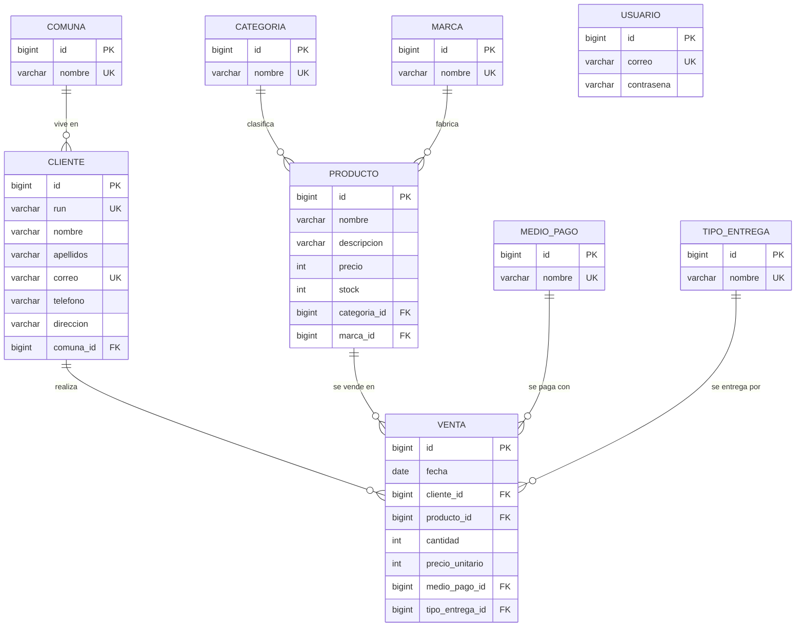

# Sonido Vivo — Backend (Semanas 1 y 2)

API REST en **Spring Boot 3.5 + MySQL** para la tienda Sonido Vivo.
Tres entidades JPA independientes (sin `@OneToMany`, `@ManyToOne` ni `@ManyToMany`): **Producto**, **Cliente** y **Venta**,
sobre una base de datos **normalizada a tercera forma normal (3FN)**.

**Semana 2** agrega:

| Herramienta | Para qué | Dónde |
| :--- | :--- | :--- |
| **Flyway** | Crea y versiona las tablas con migraciones | `src/main/resources/db/migration/` |
| **JWT** | Login con token; POST, PUT y DELETE exigen token | `security/`, `controller/AuthController.java` |
| **Swagger + HATEOAS** | Documentación interactiva; los GET traen enlaces `_links` | `config/OpenApiConfig.java`, controladores |
| **JUnit + DataFaker** | Pruebas con datos generados al azar | `src/test/java/` |

## Requisitos

- Java 17 o superior (JDK)
- MySQL 8 o **XAMPP** (MariaDB) corriendo en `localhost:3306`
- Maven no es obligatorio: el proyecto trae Maven Wrapper (`mvnw` / `mvnw.cmd`)

## 1. Ejecutar

1. Encender MySQL (XAMPP Control Panel → **Start** en MySQL).
2. Desde la carpeta `backend/`:

```bash
./mvnw spring-boot:run          # Linux / macOS
mvnw.cmd spring-boot:run        # Windows
```

No hay que importar ningún script: al arrancar, la base `sonido_vivo` se crea sola (si no existe) y **Flyway**
crea las tablas y carga los datos. La API queda en `http://localhost:8080`.

## 2. Flyway (migraciones)

Las tablas las crea Flyway, **no** Hibernate (`spring.jpa.hibernate.ddl-auto=validate`: Hibernate solo revisa que
las entidades calcen con las tablas).

| Migración | Qué hace |
| :--- | :--- |
| `V1__crear_tablas.sql` | Las 8 tablas normalizadas (PK, FK, `UNIQUE`, `CHECK`) y los catálogos |
| `V2__datos_iniciales.sql` | Productos, clientes y ventas de ejemplo |
| `V3__crear_usuario.sql` | Tabla `usuario` para el login, con el usuario de prueba |

Flyway anota en la tabla `flyway_schema_history` qué versiones ya aplicó y solo ejecuta las nuevas.
**Una migración ya aplicada no se edita**: cualquier cambio de la base va en un archivo nuevo (`V4__...sql`).

Para empezar de cero: borrar la base (`DROP DATABASE sonido_vivo;` en phpMyAdmin) y volver a arrancar.

## 3. Modelo de datos normalizado



**Por qué está en 3FN:**

- **1FN:** cada columna guarda un solo valor (atómico), no hay listas ni grupos repetidos, y cada tabla tiene llave primaria (`id`).
- **2FN:** todas las llaves primarias son de una sola columna, así que cada atributo depende de la llave completa.
- **3FN:** no hay dependencias transitivas, es decir, ningún atributo depende de otro que no sea la llave:
  - Categoría, marca, comuna, medio de pago y tipo de entrega están en **tablas de tipos** propias. En las tablas principales
    solo queda su `id` como llave foránea, así cada nombre se guarda una sola vez y no se repite texto.
  - La venta **no guarda el total**, porque es un dato calculado (`cantidad × precio_unitario`).
  - `precio_unitario` es el precio **al momento de la venta**, no una copia de `producto.precio`, que puede cambiar después.
  - Cada tabla representa un solo concepto, y todas las relaciones son de uno a muchos (1:N).

En la base de datos las relaciones existen como **llaves foráneas**. En Java, como pide la Semana 1, las entidades guardan
esos ids como números simples (`categoriaId`, `comunaId`, `clienteId`...) sin anotaciones de relación JPA.
La tabla `usuario` es independiente: solo se usa para el login.

## 4. Configuración

En [`src/main/resources/application.properties`](src/main/resources/application.properties):

| Variable de entorno | Para qué | Si no se define |
| :--- | :--- | :--- |
| `DB_USER` | Usuario de MySQL | `root` |
| `DB_PASSWORD` | Contraseña de MySQL | vacía (lo que trae XAMPP) |
| `JWT_SECRET` | Clave para firmar los tokens (mínimo 32 caracteres) | se genera una al azar en cada arranque |

Sin `JWT_SECRET` todo funciona, pero los tokens dejan de servir cada vez que se reinicia la aplicación.

## 5. Autenticación JWT

| Ruta | ¿Necesita token? |
| :--- | :--- |
| `POST /api/auth/login` | No |
| Todos los `GET` | No (el catálogo es público) |
| `POST`, `PUT`, `DELETE` de productos, clientes y ventas | **Sí** → sin token responde **401** |
| Swagger (`/swagger-ui.html`, `/v3/api-docs`) | No |

**Usuario de prueba:** `admin@duoc.cl` / `admin123` (el mismo del frontend). En la tabla se guarda solo el hash
BCrypt de la contraseña, nunca el texto.

Cómo funciona:

1. `POST /api/auth/login` con `{ "correo": "admin@duoc.cl", "contrasena": "admin123" }` responde
   `{ "token": "eyJhbGciOi...", "tipo": "Bearer", "expiraEnMinutos": 60 }` (o **401** si los datos no coinciden).
2. En las siguientes peticiones se envía el encabezado `Authorization: Bearer <token>`.
3. `JwtFiltro` revisa ese encabezado en cada petición: si la firma del token es válida y no venció, deja pasar.
   `SeguridadConfig` define qué rutas son públicas y cuáles exigen token.

## 6. Swagger y HATEOAS

Con la aplicación corriendo, abrir **http://localhost:8080/swagger-ui.html**. Para probar POST, PUT y DELETE:
ejecutar `POST /api/auth/login`, copiar el `token`, presionar **Authorize** y pegarlo.

Los **GET** responden en formato **HATEOAS** (HAL): cada registro trae `_links` con la URL de sí mismo y de la lista,
y la lista viene dentro de `_embedded`. Cada venta trae además enlaces a su cliente y a su producto:

```json
{
  "id": 1, "fecha": "2026-11-06", "clienteId": 1, "productoId": 1, "cantidad": 1, "...": "...",
  "_links": {
    "self":     { "href": "http://localhost:8080/api/ventas/1" },
    "ventas":   { "href": "http://localhost:8080/api/ventas" },
    "cliente":  { "href": "http://localhost:8080/api/clientes/1" },
    "producto": { "href": "http://localhost:8080/api/productos/1" }
  }
}
```

## Estructura

```
backend/
└── src/main/
    ├── java/cl/duoc/sonidovivo/
    │   ├── SonidoVivoApplication.java   Clase principal
    │   ├── config/       OpenApiConfig (Swagger + boton Authorize)
    │   ├── model/        Entidades JPA: Producto, Cliente, Venta, Usuario
    │   ├── repository/   Interfaces que heredan de JpaRepository<Entidad, Long>
    │   ├── service/      Lógica CRUD (@Service, repositorio inyectado por constructor)
    │   ├── controller/   Controladores REST, AuthController (login) y ManejadorErrores
    │   └── security/     SeguridadConfig, JwtFiltro y JwtServicio
    └── resources/
        ├── application.properties
        └── db/migration/ V1, V2 y V3 (Flyway)
```

## Endpoints

Los mismos 5 endpoints para cada entidad (`productos`, `clientes`, `ventas`):

| Método | Ruta | Acción | Token | Respuesta |
| :--- | :--- | :--- | :--- | :--- |
| GET | `/api/productos` | Obtener todos | No | 200 + lista con `_links` |
| GET | `/api/productos/{id}` | Buscar por ID | No | 200 con `_links`, o 404 |
| POST | `/api/productos` | Crear nuevo | Sí | 201 + registro creado |
| PUT | `/api/productos/{id}` | Actualizar existente | Sí | 200, o 404 si no existe |
| DELETE | `/api/productos/{id}` | Eliminar por ID | Sí | 204, o 404 si no existe |

Cambiar `productos` por `clientes` o `ventas` para las otras entidades (15 endpoints en total), más `POST /api/auth/login`.

Si la operación rompe una regla de la base de datos, la API responde **409 Conflict** con un mensaje.
Por ejemplo: un `categoriaId` que no existe, un RUN o correo repetido, o eliminar un cliente que tiene ventas.

### Ejemplos de JSON (para Postman o Swagger)

**Producto** — `POST /api/productos` (categoriaId 1 = Guitarras, marcaId 1 = Fender)

```json
{ "nombre": "Guitarra Electrica Stratocaster", "descripcion": "3 pastillas single coil",
  "precio": 349990, "stock": 5, "categoriaId": 1, "marcaId": 1 }
```

**Cliente** — `POST /api/clientes` (comunaId 1 = Viña del Mar; `run` y `correo` no se pueden repetir)

```json
{ "run": "21111111K", "nombre": "Valentina", "apellidos": "Soto Díaz", "correo": "vale@gmail.com",
  "telefono": "987654321", "direccion": "Calle Álvarez 455", "comunaId": 1 }
```

**Venta** — `POST /api/ventas` (medioPagoId 2 = Débito, tipoEntregaId 1 = Retiro en tienda)

```json
{ "fecha": "2026-11-06", "clienteId": 1, "productoId": 1, "cantidad": 1,
  "precioUnitario": 349990, "medioPagoId": 2, "tipoEntregaId": 1 }
```

Para actualizar se envía el JSON completo con `PUT /api/<entidad>/{id}`.
Los ids de los catálogos están comentados en [`V2__datos_iniciales.sql`](src/main/resources/db/migration/V2__datos_iniciales.sql).

## Pruebas (JUnit + DataFaker)

```bash
./mvnw test
```

Usan una base **H2 en memoria** (configurada solo en `src/test/resources`), así que no necesitan MySQL encendido.
Flyway ejecuta sobre H2 **las mismas migraciones** V1, V2 y V3. Los datos de cada registro de prueba (nombres,
direcciones, precios, fechas...) los genera **DataFaker** al azar en cada ejecución.

| Clase | Qué prueba |
| :--- | :--- |
| `CrudEndpointsTest` (5) | Los 5 endpoints de Producto, Cliente y Venta con token y datos de DataFaker, los enlaces HATEOAS y el 409 |
| `AutenticacionTest` (7) | Login correcto e incorrecto, GET públicos, 401 sin token o con token falso, y Swagger público |
